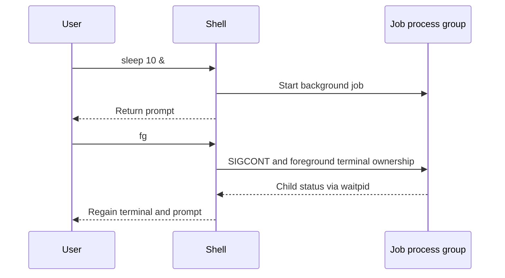

# PennShell

**A Unix shell in C with pipelines, I/O redirection, process groups, signals and foreground/background job control.**

I built PennShell with Mytreyi Narayanaswamy for Penn CIS 548. We pair-programmed over Zoom and contributed roughly equally. It implements the machinery behind commands such as `printf hello | wc -c`, redirecting output to a file, and stopping or resuming jobs.

## How a command runs

PennShell reads a command through its interactive or file-input path and uses the supplied parser to identify jobs. It then forks processes, connects pipeline stages with file descriptors, applies redirection, and manages terminal ownership for foreground work. A linked-list job queue tracks processes that continue in the background.

For `printf hello | wc -c`, the first process writes into a pipe and the second reads from it. For `sleep 10 &`, the shell returns to its prompt while retaining a job entry that can be listed or brought back to the foreground.

## What it does

- Forks and executes commands, including multi-command pipelines.
- Redirects standard input and output with file descriptors.
- Separates process groups and hands the terminal to foreground jobs.
- Handles terminal signals and tracks background job state.
- Implements `jobs`, `bg` and `fg` for interactive job control.

| Component | Source |
| --- | --- |
| Execution, pipes, redirection and terminal control | [penn_shell.c](penn_shell.c) |
| Signal handling | [interrupt_handlers.c](interrupt_handlers.c) |
| Background job queue | [linked_list.c](linked_list.c) |
| Interactive and file input | [input_reader.c](input_reader.c) |
| Error handling | [error_handlers.c](error_handlers.c) |

## Execution and file descriptors

For a pipeline with `N` commands, the execution loop allocates `N - 1` pipes and forks the command processes. Each child connects the appropriate pipe ends or redirected files to standard input/output before executing its command. Closing unused pipe descriptors matters because an extra open writer can prevent a reader from observing EOF.


For `printf hello | wc -c`, the first child's standard output feeds the second child's standard input. The shell remains responsible for the job even though the command processes perform the data transfer.

## Job control and terminal ownership

A job can contain several processes, so the implementation tracks a process group as well as individual child PIDs. `tcsetpgrp` assigns the terminal to foreground work. `waitpid` reports child status, and the linked-list job queue retains background or stopped jobs between prompts.



The `bg` path sends `SIGCONT` to the process group while keeping the shell interactive. The `fg` path also transfers terminal ownership and waits for foreground status changes. The source polls with `WNOHANG | WUNTRACED` to notice background completion and stops. These paths are worth reading together with [signal handlers](interrupt_handlers.c), since terminal signals and child status are separate mechanisms.

## Run it

The course-supplied `parsejob.o` requires Linux x86-64. The container supplies the matching build environment, including on Apple Silicon:

```sh
docker build --platform linux/amd64 -t penn-shell .
docker run --rm -it --network none penn-shell ./penn-shell
```

Example commands inside PennShell:

```sh
printf hello | wc -c
echo hello > message.txt
cat < message.txt
sleep 10 &
jobs
```

The pipeline prints `5`, and reading `message.txt` prints `hello`. Run `jobs` before the background sleep finishes to see its entry. Interactive `fg` and `bg` commands provide foreground/background control; their implementation is in [penn_shell.c](penn_shell.c).

Exit with Ctrl-D. On Linux x86-64 with Clang and Make installed, `make` builds `./penn-shell` directly.

## Context and credit

Jai Ashar and Mytreyi Narayanaswamy, Spring 2021. The [original submission README](ORIGINAL_README.md) documents our shared contribution. The Makefile retains Hannah Pan's author notice; the parser header/object are supplied course dependencies. See [PROVENANCE.md](PROVENANCE.md).

## Validation

Build and smoke-test results are recorded in [VALIDATION.md](VALIDATION.md).
